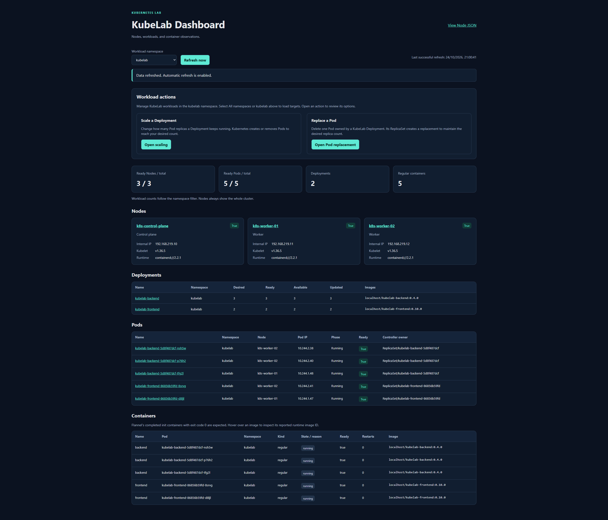

# KubeLab — Kubernetes Lab Dashboard

KubeLab is a small learning project built from a Windows PC, three manually created Ubuntu VMs, and a kubeadm Kubernetes cluster. Its own frontend and backend are the workloads used to observe scheduling, scaling, Pod replacement, and worker failure.

The application uses HTML, CSS, vanilla JavaScript, Python/FastAPI, and the official Kubernetes Python client. It has two Deployments, no database, and no separate demo application.

## What the dashboard does

- Lists Nodes, Pods, containers, images, restart counts, and Deployment replica counts.
- Opens Node, Pod, and Deployment inspectors.
- Filters workload data by namespace; Node information remains cluster-wide.
- Scales `kubelab-backend` and `kubelab-frontend` from 1 to 6 replicas.
- Deletes an owned Pod so Kubernetes can create its replacement.
- Refreshes five seconds after each completed read batch at rest. Confirmed actions temporarily use 500 ms between batches, including while the request is pending and for 30 seconds afterward.

There is intentionally **no dashboard login, operator token, or connect/disconnect flow**, following the project's chosen lab policy. Anyone who can reach the application can read the exposed cluster information and request its bounded actions. Kubernetes still authenticates the backend with its ServiceAccount; application ownership checks and RBAC limit what it can change.

## Lab layout

Windows 11 runs WSL2 Ubuntu for administration/development and VMware Workstation Pro for the three Kubernetes VMs. **WSL is not a Kubernetes node.**

| VM | Role | Static address | Suggested fresh-lab sizing |
| --- | --- | --- | --- |
| `k8s-control-plane` | Control plane | `192.168.219.10` | 2 vCPU, 4 GiB RAM, 40 GB disk |
| `k8s-worker-01` | Worker | `192.168.219.11` | 2 vCPU, 4 GiB RAM, 40 GB disk |
| `k8s-worker-02` | Worker | `192.168.219.12` | 2 vCPU, 4 GiB RAM, 40 GB disk |

The VMware NAT network is `192.168.219.0/24`, with gateway/DNS `192.168.219.2`. Flannel uses Pod range `10.244.0.0/16`; Services use `10.96.0.0/12`.

The [HTTPS dashboard](https://192.168.219.10:30443) is available when the three VMs are running and the browser trusts the public lab CA certificate. HTTP port 30080 redirects application requests to HTTPS; its health endpoint remains available.

## Technologies and prerequisites

| Component | Recorded baseline | Official reference |
| --- | --- | --- |
| Host/admin environment | Windows 11, WSL2 Ubuntu 24.04 | [WSL installation](https://learn.microsoft.com/en-us/windows/wsl/install) |
| VM platform | VMware Workstation Pro | [Broadcom download guidance](https://knowledge.broadcom.com/external/article/344595/downloading-vmware-workstation-pro.html) |
| VM operating system | Ubuntu Server 24.04 LTS, amd64 | [Ubuntu 24.04 images](https://releases.ubuntu.com/24.04/) |
| Kubernetes tools | kubeadm, kubelet and kubectl 1.36.5 | [Kubeadm installation](https://v1-36.docs.kubernetes.io/docs/setup/production-environment/tools/kubeadm/install-kubeadm/) |
| Node runtime / networking | containerd 2.2.1; Flannel 0.28.10, VXLAN | [containerd](https://containerd.io/docs/), [Flannel](https://github.com/flannel-io/flannel) |
| Automation / image builds | ansible-core 2.21.5; rootless Podman in WSL | [Ansible](https://docs.ansible.com/), [Podman installation](https://podman.io/docs/installation) |
| Backend | Python 3.12; FastAPI 0.156.1; Uvicorn 0.54.0; Kubernetes client 36.0.3 | [Python environments](https://docs.python.org/3.12/library/venv.html), [official Kubernetes client](https://github.com/kubernetes-client/python) |

The recorded physical host has 32 GB RAM, hardware virtualization, space for the three VM disks and image archives, outbound package/image access, WSL-to-VM SSH/API connectivity.

## Application images

| Deployment | Image | Baseline replicas |
| --- | --- | --- |
| `kubelab-backend` | `localhost/kubelab-backend:1.0.0` | 3 |
| `kubelab-frontend` | `localhost/kubelab-frontend:1.0.0` | 2 |

Podman builds the images in WSL. Docker-format archives and SHA256 checksums are transferred to both workers, then imported into containerd's `k8s.io` namespace. The Deployments use `imagePullPolicy: Never`.

## Project structure

```text
KubernetesLabDashboard/
├── README.md
├── backend/
│   ├── app/
│   ├── requirements.txt
│   └── Dockerfile
├── frontend/
│   ├── index.html, styles.css
│   ├── app.js, actions.js, details.js
│   ├── nginx.conf
│   └── Dockerfile
├── ansible/
│   ├── inventory/
│   ├── files/
│   ├── playbooks/
│   └── requirements.txt
├── k8s/
│   ├── kubelab/
│   └── diagnostics/
└── docs/
    ├── architecture.md
    ├── experiments.md
    └── screenshots/
```

## Guides and screenshots

- [Architecture, TLS and permissions](docs/architecture.md)
- [Scaling and replacement experiments](docs/experiments.md)

| Screenshot | View |
| --- | --- |
| [Dashboard](docs/screenshots/dashboard.png) | Cluster overview |
| [Node details](docs/screenshots/node_example.png) | Node information and assigned Pods |
| [Deployment details](docs/screenshots/deployment_example.png) | Deployment information and owned Pods |
| [Pod details](docs/screenshots/pod_example.png) | Pod information and containers |
| [Scaling](docs/screenshots/scaling.png) | Replica counts and scale controls |
| [Replacing](docs/screenshots/replacing.png) | Pod ownership and replacement controls |

