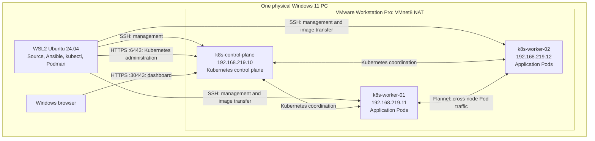

# Architecture

KubeLab is a small educational Kubernetes environment running on one Windows PC. Three Ubuntu Server VMs form the cluster; a separate WSL Ubuntu environment manages them and builds the dashboard. The dashboard's own frontend and backend provide the workloads used to explore scheduling, scaling, Pod replacement and worker failure.

This document describes the lab's construction, component responsibilities and connections.

## 1. Physical host, WSL and the three VMs

Windows 11 runs VMware Workstation Pro, WSL2 and the browser. VMware supplies the three Kubernetes VMs, each with its own Ubuntu installation, virtual CPU/RAM allocation, system disk and network interface. WSL2 provides a separate Linux environment for development and administration. The Kubernetes VMs run under VMware alongside WSL.

The diagram separates management connections from application traffic. The control-plane address is the normal browser entry point; its NodePort can forward to frontend Pods on either worker.

| Machine | Role in this lab | Main software or workloads |
| --- | --- | --- |
| Windows 11 host | Hosts the lab and displays the dashboard | VMware Workstation Pro, WSL2, browser |
| WSL2 Ubuntu 24.04 | Development, automation and image building | Project source, Python environments, SSH, Ansible, kubectl, Podman |
| `k8s-control-plane` VM — `192.168.219.10` | Owns Kubernetes coordination and cluster state | API server, etcd, scheduler, controller manager, kubelet, containerd, networking components |
| `k8s-worker-01` VM — `192.168.219.11` | Executes application Pods | kubelet, containerd/runc, Flannel, kube-proxy, frontend/backend replicas |
| `k8s-worker-02` VM — `192.168.219.12` | Provides a second application scheduling destination | Same worker stack as worker 01 |

All three Kubernetes VMs use Ubuntu Server 24.04 LTS on AMD64. The recorded cluster uses Kubernetes **1.36.5**, containerd **2.2.1** and Flannel **0.28.10**. Exact VM CPU/RAM/disk allocations are VMware settings and are not declared in this repository.

## 2. What lives in WSL

The working project is stored in the WSL Linux filesystem at `~/projects/KubernetesLabDashboard`. Python virtual environments separate backend development dependencies from Ansible's dependencies. WSL is the **Ansible control node**: the machine that launches automation. This role is separate from the **Kubernetes control-plane VM**.

| WSL tool | Responsibility |
| --- | --- |
| SSH | Opens authenticated connections to the Ubuntu VMs and carries Ansible operations |
| Ansible | Applies the saved Ubuntu, runtime and Kubernetes configuration to selected VM groups |
| kubectl | Sends administrative requests to the Kubernetes API |
| Rootless Podman | Builds and exports frontend/backend container images |
| Python and the project source | Support development of the FastAPI backend and automation |

The WSL administrator uses the private kubeconfig at `~/.kube/kubelab.config` to authenticate to `https://192.168.219.10:6443`. SSH uses the lab key at `~/.ssh/id_ed25519_kubelab`; the inventory connects as the VM user `pedro`. Credentials and generated private certificates stay outside the repository.

Once deployed, the dashboard runs inside the worker VMs. Its normal operation does not depend on a development server, Podman process or Ansible process remaining open in WSL.

## 3. What makes the control plane and workers different

### Control-plane VM

kubeadm initializes `k8s-control-plane` using [the cluster configuration](../ansible/files/kubeadm/init.yaml). It declares the cluster name `kubelab`, API endpoint `192.168.219.10:6443`, Pod/Service address ranges and the kubelet's systemd cgroup driver.

| Component | Responsibility |
| --- | --- |
| API server | Accepts authenticated requests to read or change Kubernetes objects |
| etcd | Persists Kubernetes cluster configuration and object state on the control-plane VM's disk |
| Scheduler | Assigns unscheduled Pods to eligible Nodes |
| Controller manager | Runs reconciliation loops that move actual cluster state toward the declared state |

kubeadm creates local static-Pod definitions for these components, which the control-plane kubelet runs through containerd. The VM also participates in cluster networking. Application placement targets the labeled workers.

### Worker VMs

Each worker joins the same cluster through the control-plane API, using kubeadm bootstrap credentials. It receives a node identity and kubelet configuration; it does not become another control plane.

Both workers run kubelet and containerd, plus node networking components. **Flannel** connects Pod networks between VMs. **kube-proxy** maintains Service forwarding on the Nodes. **CoreDNS** provides cluster DNS as a Deployment; its system Pods have separate placement rules from the dashboard's worker selection.

The workers are labeled `kubelab.io/workloads=enabled`. Both application Deployments select that label, making either worker eligible for frontend and backend Pods. A Pod is a Kubernetes workload unit containing one or more containers; it is not a separate VMware VM.

### Automatic startup after the VMs boot

The saved Ansible configuration enables containerd and kubelet as Ubuntu services. With the VM disks and cluster configuration preserved, a normal boot resumes the deployed workloads:

1. **Ubuntu starts the node services.** systemd launches containerd and kubelet automatically on each VM.
2. **The control plane starts again.** Its kubelet reads the saved static-Pod definitions and uses containerd to start etcd, the API server, scheduler and controller manager. Existing etcd data retains the cluster objects and their last saved desired replica counts.
3. **The workers resume their assigned workloads.** Their kubelets reconnect to the API and ensure the assigned Pod containers are running through containerd, using the images already stored locally. The backend starts Uvicorn and the frontend starts Nginx inside those containers.
4. **The dashboard becomes reachable.** Cluster networking and Service forwarding recover, and ready application Pods become available through the frontend NodePort.

The deployed backend runs inside the worker VMs, which use the physical PC's resources. Windows being on while the VMs are off does not run that backend. VMware VM power-on is separate from Ubuntu's automatic service startup.

Normal startup does not require a development backend or Ansible running in WSL. It resumes the saved cluster state, including replica counts changed through the dashboard, rather than applying the manifest defaults again. 

## 4. Networks and connections

The VM network, Pod network and Service network serve different purposes:

| Address space | Lab value | Purpose |
| --- | --- | --- |
| VMware VMnet8 NAT | `192.168.219.0/24` | VM interfaces, SSH, Kubernetes API and browser NodePort access |
| VM gateway / DNS forwarder | `192.168.219.2` | Outbound VM connectivity and external DNS |
| Pod network | `10.244.0.0/16` | Addresses for Pod networking across Nodes |
| Service network | `10.96.0.0/12` | Virtual ClusterIP addresses for stable access to groups of Pods |
| Cluster DNS domain | `cluster.local` | Names such as `kubelab-backend.kubelab.svc.cluster.local` |

The three VM addresses are static Netplan settings on their Ubuntu interfaces. They share VMware's VMnet8 network, allowing direct VM-to-VM communication and access from the Windows host and WSL. VMware NAT provides outbound connectivity; it does not imply that the dashboard is publicly reachable from the Internet. WSL has its own networking environment and is not assigned one of these three Kubernetes Node addresses.

Flannel runs as a DaemonSet across the Nodes. Its VXLAN overlay transports Pod traffic over the underlying VM network, allowing a Pod on one worker to reach a Pod on the other. CNI plugins create and configure the local Pod network interfaces. A replacement Pod can receive a different IP.

A Service supplies a stable virtual address and DNS name while its selected ready Pod endpoints change. CoreDNS handles Service name lookups; it is separate from the VM DNS forwarder. Plain Flannel does not provide NetworkPolicy enforcement in this lab.

| Connection | Transport / port | Used for |
| --- | --- | --- |
| WSL → all VMs | TCP 22 | SSH, Ansible and image archive transfer to workers |
| WSL and cluster clients → control plane | HTTPS, TCP 6443 | Kubernetes API |
| Control plane → node kubelets | TCP 10250 | kubelet API |
| Node ↔ Node | UDP 8472 | Flannel VXLAN traffic |
| Browser → reachable Node | HTTPS, TCP 30443 | Dashboard |
| Browser → reachable Node | HTTP, TCP 30080 | HTTPS redirect; frontend health endpoint |

These are the main architectural connections, not a complete firewall rule set. The saved network playbook audits existing firewall rules; it does not disable the firewall or install a complete firewall policy.

## 5. Ansible's place in the architecture

The [inventory](../ansible/inventory/hosts.yml) groups all three VMs under `k8s_cluster`, with separate `control_plane` and `workers` groups. Shared settings specify the remote user, SSH key and `/usr/bin/python3`. Ansible connects from WSL over SSH and uses privilege escalation for system changes; no persistent Ansible agent runs on a VM.

The saved playbooks divide responsibilities by layer:

| Saved configuration | Architectural responsibility |
| --- | --- |
| [Node identification](../ansible/playbooks/manage_node_info.yml) and [OS updates](../ansible/playbooks/update_nodes.yml) | Manage a lab identification file, Ubuntu updates and requested reboots |
| [Node baseline](../ansible/playbooks/prepare_node_base.yml) | Host identity, name mappings, time synchronization and disabled swap |
| [Node networking](../ansible/playbooks/prepare_node_network.yml) | Kernel modules, IPv4 routing/bridge settings, connectivity checks and firewall inspection |
| [Container runtime](../ansible/playbooks/install_containerd.yml) | Install, configure and verify containerd/runc |
| [Kubernetes packages](../ansible/playbooks/install_kubernetes.yml) | Matching Kubernetes packages, package holds and CRI configuration |
| [Control-plane initialization](../ansible/playbooks/init_control_plane.yml) | kubeadm initialization, API readiness, administrator configuration and saved Flannel manifest |
| [Worker membership](../ansible/playbooks/join_workers.yml) | Join both workers to the existing control plane |
| [Image distribution](../ansible/playbooks/distribute_images.yml) | Copy, verify and import application images on both workers |

The playbooks check expected conditions and guard bootstrap completion. Inconsistent partial initialization is rejected rather than automatically resetting a cluster. VMware VM creation, initial static addressing and initial SSH access are outside these playbooks. No single playbook provisions the complete lab.

Ansible manages machine configuration when invoked. Kubernetes controllers continue managing Pods and Services after Ansible has finished.

## 6. Application image and deployment flow

Both application releases stay fixed at **1.0.0**:

| Component | Image | Image contents |
| --- | --- | --- |
| Backend | `localhost/kubelab-backend:1.0.0` | Python 3.12, FastAPI, Uvicorn and the official Kubernetes Python client |
| Frontend | `localhost/kubelab-frontend:1.0.0` | Unprivileged Nginx, HTML, CSS and vanilla JavaScript |

The delivery path is **WSL source → Podman images → Docker-format archives → Ansible/SSH → each worker's containerd → Kubernetes Pods**.

The distribution playbook imports the application image archives into containerd's `k8s.io` namespace on both workers and verifies that CRI resolves the tags to the expected IDs.

The manifests use `imagePullPolicy: Never`. Every eligible worker therefore needs both images locally; the `localhost/` prefix does not represent a running image registry. Because version 1.0.0 is reused, the image tag alone does not identify the build's contents; checksums and configuration IDs distinguish builds.

## 7. Dashboard workloads and request path

The application Deployments, Services, Secrets and CA ConfigMap live in namespace `kubelab`. The [backend manifest](../k8s/kubelab/backend.yaml) declares three replicas; the [frontend manifest](../k8s/kubelab/frontend.yaml) declares two. Each application Pod contains one regular container.

```mermaid
flowchart LR
    browser["Browser<br/>HTTPS :30443"]
    nodeport["Reachable Node<br/>NodePort 30443"]
    frontsvc["Frontend Service<br/>:8443"]
    frontend["Nginx frontend Pod<br/>HTTPS :8443"]
    backsvc["Backend ClusterIP Service<br/>:8443"]
    backend["FastAPI backend Pod<br/>HTTPS :8443"]
    api["Kubernetes API<br/>:6443"]
    browser --> nodeport --> frontsvc --> frontend
    frontend -->|"Verified upstream HTTPS"| backsvc
    backsvc --> backend
    backend -->|"ServiceAccount authentication"| api
```

| Service | Type | Port mapping |
| --- | --- | --- |
| `kubelab-frontend` | NodePort | 30443 → Service 8443 → frontend HTTPS 8443 |
| `kubelab-frontend` HTTP port | Same NodePort Service | 30080 → Service 8080 → frontend HTTP 8080 |
| `kubelab-backend` | ClusterIP | Service 8443 → backend HTTPS 8443 |

The frontend Service uses `externalTrafficPolicy: Cluster`, allowing a reachable Node to forward to ready frontend Pods on another Node. The control-plane VM can therefore expose the dashboard even though its application Pods run on workers.

Nginx serves the static website and proxies `/api/...` requests to the backend Service. The browser uses one origin for the page and API. HTTP application requests redirect to HTTPS; the frontend `/healthz` endpoint also responds on HTTP. The backend Service is internal to Kubernetes. No Ingress controller or external load balancer is deployed.

## 8. TLS, identities and permissions

Application TLS uses a private lab CA. The browser trusts its public certificate, while `kubelab-frontend-tls` and `kubelab-backend-tls` Secrets supply the respective server certificates and keys. The public CA ConfigMap, `kubelab-application-ca`, is mounted in frontend Pods.

Nginx terminates the browser connection and starts a separate HTTPS connection to the backend. It verifies the backend certificate against the application CA and the name `kubelab-backend.kubelab.svc.cluster.local`. The backend's HTTPS connection to the Kubernetes API uses the cluster's own CA and in-cluster credentials.

The three access identities have different roles:

| Identity | Access |
| --- | --- |
| WSL administrator kubeconfig | Human administration of the cluster |
| Backend `kubelab-backend` ServiceAccount | The dashboard's limited Kubernetes API access |
| Browser visitor | Dashboard access without an application login or operator token |

[Reader RBAC](../k8s/kubelab/rbac.yaml) allows cluster-wide listing of Nodes, Pods, Deployments and ReplicaSets. [Action RBAC](../k8s/kubelab/actions-rbac.yaml) adds scoped permissions in `kubelab`: read/scale the two allowed Deployments, read ReplicaSets and read/delete Pods. The backend also validates ownership and object identity before changing a resource. It has no Secret-read API grant or cluster-admin grant.

Backend containers run as UID/GID 10001; frontend containers as 101. Their security settings drop capabilities, prohibit privilege escalation and use a read-only root filesystem. Pod group permissions allow the non-root processes to read projected TLS files. The backend receives a ServiceAccount token; frontend token automount is disabled.

HTTPS protects traffic, while any client that can reach the dashboard can request its bounded actions under the chosen lab policy. Private CA keys, TLS keys, SSH keys and kubeconfigs remain outside published source.

## 9. How reads and actions reach Kubernetes

The backend reads Kubernetes objects through the official Python client and returns dashboard summaries. The frontend displays Nodes, Deployments, Pods and their containers, with popups for resource details.

Namespace selection filters Pods and Deployments. **Nodes always describe the whole cluster**, because Nodes are cluster resources. A Node can host Pods from several namespaces; its inspector lists Pods within the selected workload scope.

At rest, the frontend starts a read batch five seconds after the preceding batch completes. Confirmed actions temporarily use 500 ms between completed batches, starting before the action request and continuing through its pending period and for 30 seconds afterward. Failed refreshes retain the previous view as stale; old namespace responses are discarded.

The two write operations are:

- **Scale a Deployment:** the backend validates the selected Deployment UID and an integer count from 1 to 6, then updates its Scale subresource. Controllers reconcile the desired number of Pods.
- **Replace a Pod:** the backend validates the Pod UID and its Pod → ReplicaSet → allowed Deployment ownership chain, then deletes that exact Pod with identity/version preconditions. Its ReplicaSet creates the replacement without changing the desired count.

Actions are limited to `kubelab-backend` and `kubelab-frontend` in `kubelab`. Mismatched object identities, deletion in progress and conflicting writes are rejected. A successful HTTP 202 means the request was accepted; reconciliation and readiness can happen afterward. The action dialog closes and the page moves to the Pods list to observe those changes. Action requests are not automatically repeated after uncertain outcomes.