# Experiments

The following screenshots record two dashboard experiments in the `kubelab` namespace, with backend and frontend images at version **1.0.0**.

## 1. Scaling a Deployment

The backend is reduced from three replicas to two and then restored to three. The frontend remains at two replicas.

### 1.1. Initial dashboard

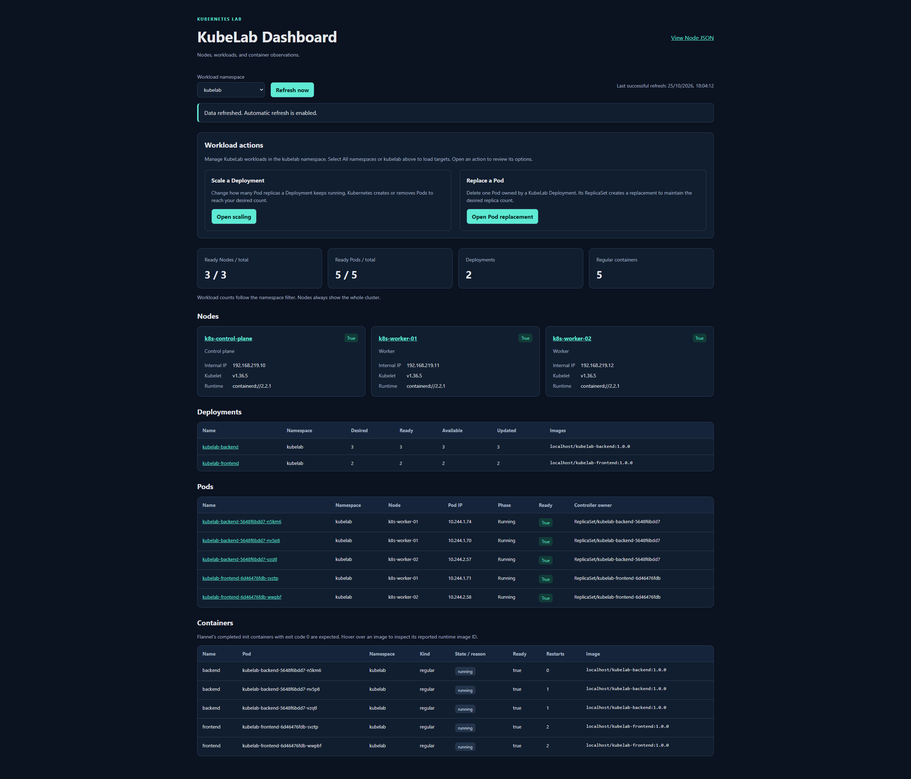

All three Nodes and five application Pods are Ready. The backend Deployment has three replicas and the frontend has two.

### 1.2. Current replica count

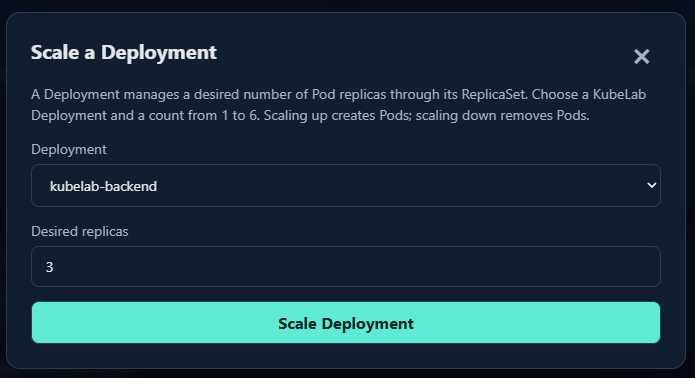

The scaling dialog shows `kubelab-backend` with a desired replica count of three.

### 1.3. Scale-down selection

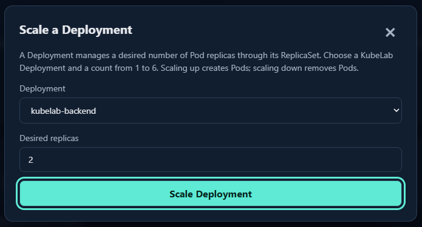

The requested backend replica count is set to two, preparing a reduction from three replicas.

### 1.4. Pod deletion during scale-down

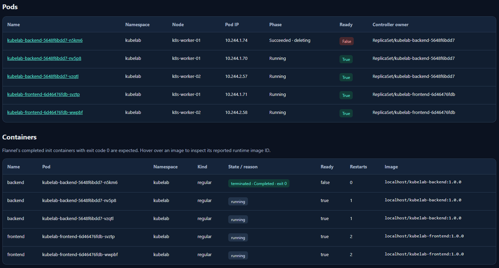

One backend Pod appears as `Succeeded · deleting` with `Ready=False`; its container reports `Completed` with exit code 0. The other two backend Pods and both frontend Pods remain Running and Ready.

### 1.5. Scale-down complete

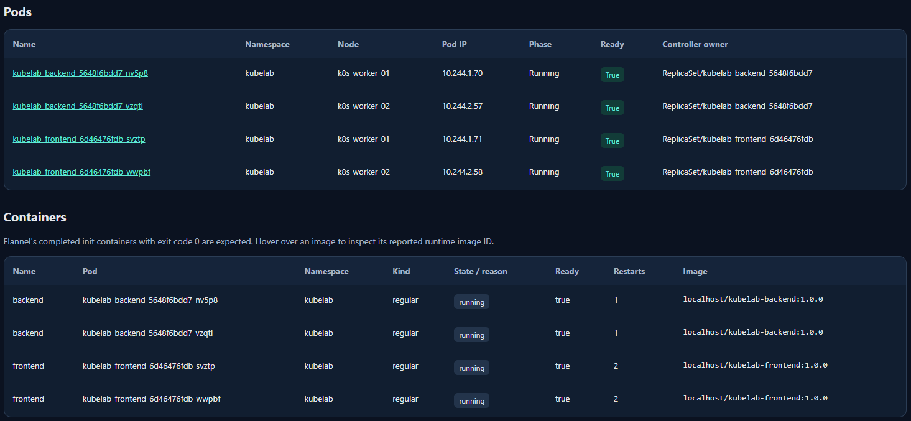

The deleted Pod is no longer listed. Four Running and Ready Pods remain: two backend replicas and two frontend replicas.

### 1.6. Scale-up selection

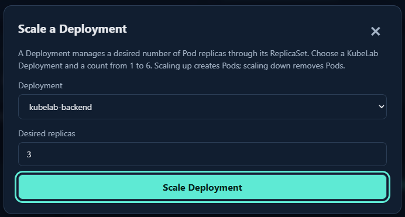

The requested backend replica count is set back to three, preparing the creation of an additional backend Pod.

### 1.7. New Pod starting

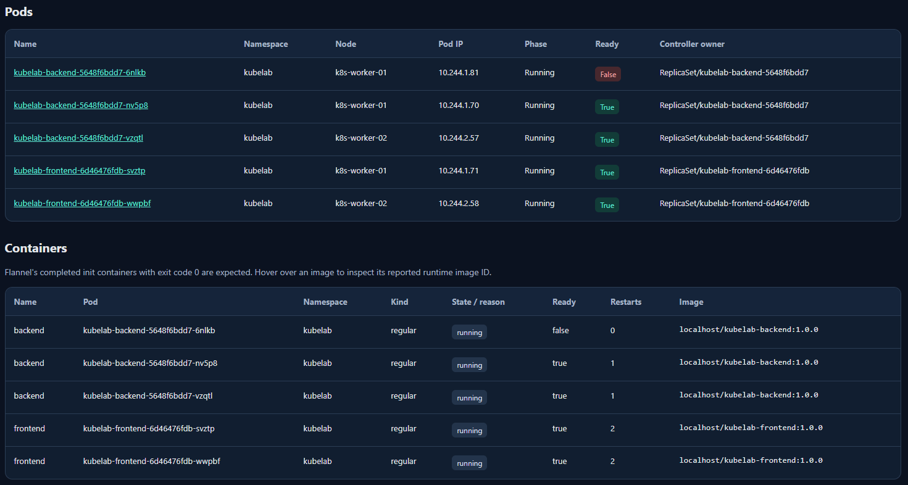

A new backend Pod appears on `k8s-worker-01` in the `Running` phase with `Ready=False`. The container is running, but the Pod is not yet Ready.

### 1.8. Scale-up complete

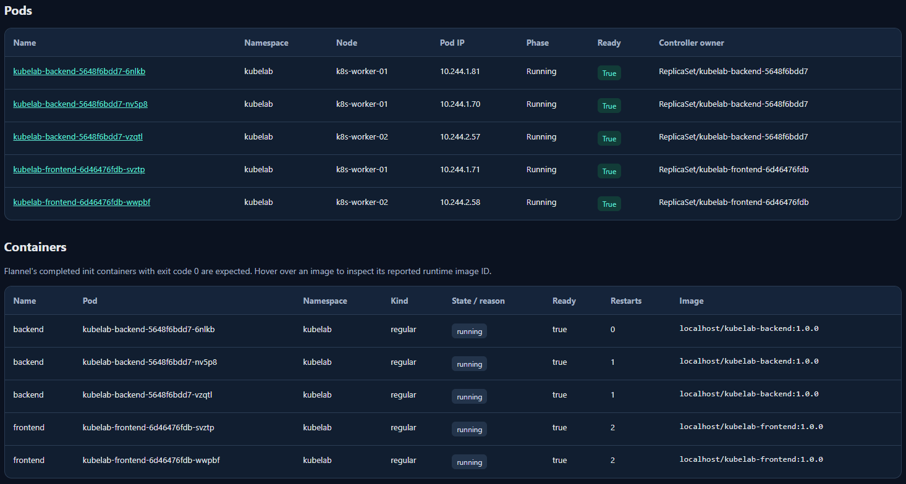

The new backend Pod now reports `Ready=True`. All five Pods are Running and Ready again: three backend replicas and two frontend replicas.

## 2. Replacing a Pod

One backend Pod is deleted and its ReplicaSet creates a replacement automatically. The desired backend count stays at three replicas.

### 2.1. Initial dashboard

All three Nodes and five application Pods are Ready. The Deployments request three backend replicas and two frontend replicas.

### 2.2. Replacement selection

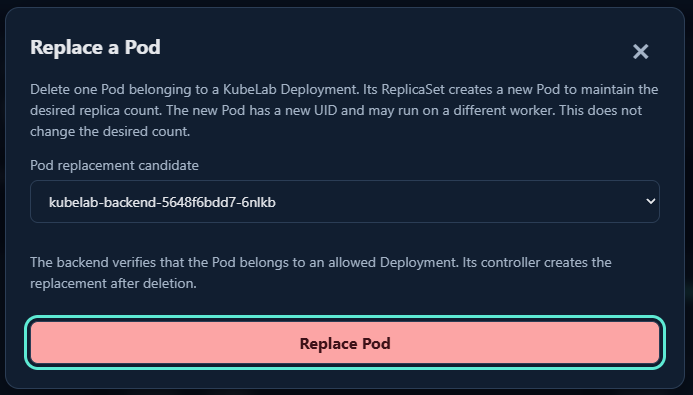

Backend Pod `kubelab-backend-5648f6bdd7-6nlkb` is selected for replacement. The preceding overview places this Pod on `k8s-worker-01`.

### 2.3. Replacement in progress

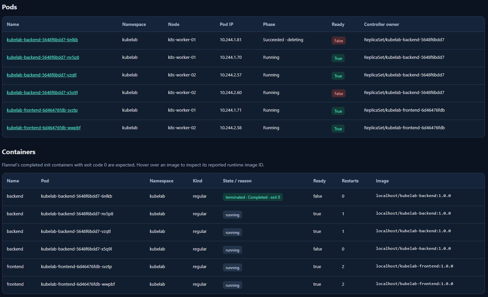

The old Pod is `Succeeded · deleting` with `Ready=False`. Its replacement, ending in `x5q9l`, is already `Running` on `k8s-worker-02` with `Ready=False`; the two records temporarily appear together.

### 2.4. Replacement complete

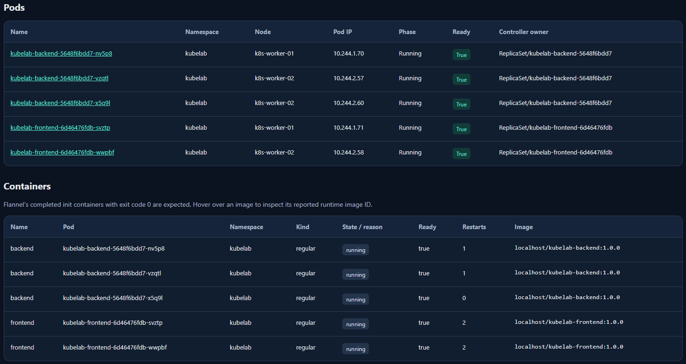

The old Pod is no longer listed, and `kubelab-backend-5648f6bdd7-x5q9l` is Running and Ready on `k8s-worker-02`. Three backend Pods and two frontend Pods remain, preserving the original replica counts.
